## Motivation {#why-hard}

[How do households respond to perceived income uncertainty?]{.slide-takeaway}
```{=html}
<div class="prose motivation-points">
<ul>
<li>Households face many sources of uncertainty.</li>
<li class="fragment" data-fragment-index="1"><strong>Household income uncertainty</strong> is a central one.
<ul>
<li>Income provides the resources households use to finance their needs.</li>
<li>Income uncertainty shapes key household decisions: <strong>consumption, saving, and debt repayment</strong>.</li>
</ul>
</li>
<li class="fragment" data-fragment-index="2">Understanding how households respond to perceived income uncertainty is a <a href="#/lit">longstanding</a> and important question.
<ul>
<li>
```

[@leland_saving_1968; @carroll_buffer-stock_1997; @jappelli_fiscal_2014; @wang_perceived_2023; @caplin_subjective_2023; @kosar_subjective_2025].

```{=html}
</li>
</ul>
</li>
<li class="motivation-challenge-bridge fragment" data-fragment-index="3">Yet key challenges remain.</li>
</ul>
</div>
```

## Main challenges {#main-challenges}

::: {.prose .motivation-points}

1. **Measurement:** Measure households’ perceived uncertainty about future income [@manski_survey_2018; @wang_perceived_2023; @caplin_subjective_2023].

2. **Causal identification:** Obtain exogenous variation in income uncertainty while holding expected income constant.

:::

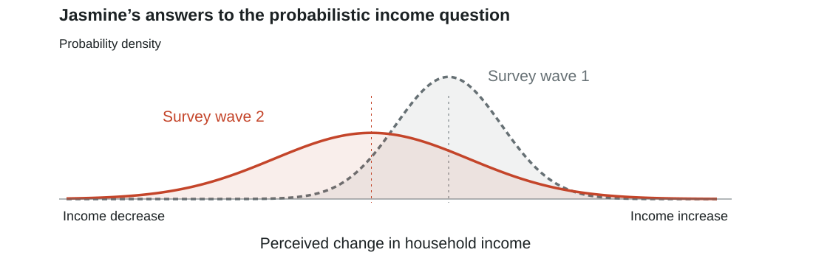{width="1000" height="318" fig-alt="Illustrative subjective income distributions across two survey waves, showing that expected income and perceived uncertainty may move together."}

## This paper (1/2) {#panel}

::: {.prose}
[**Address two challenges in one vignette experiment embedded in a representative German household online survey.**]{.paper-highlight}

::: {.claims .incremental}
1. **Measurement: perceived uncertainty about future income**

   [**My solution:** directly elicit perceived income uncertainty.]{.challenge-solution}<br>
   [**How:**]{.design-how} the probabilistic income question in the German central bank household online survey. [Question example](#measure){.example-button} [Sample](#sample){.example-button}

2. **Causal identification: vary uncertainty while holding expected income constant**

   [**My solution:** exogenously vary income uncertainty through mean-preserving spreads.]{.challenge-solution}<br>
   [**How:**]{.design-how} randomly assign income spreads in a vignette experiment. [Vignette example](#mean-preserving-spread){.example-button}
:::
:::

::: {.paper-vignette}
::: {.paper-spread}
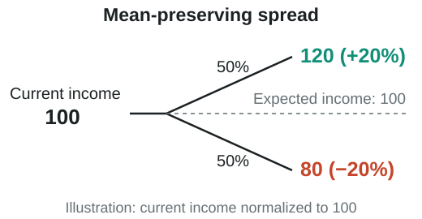{width="520" height="270" fig-alt="Current income normalized to 100 becomes 120 or 80 with equal probabilities. Expected income remains 100."}
:::
::: {.paper-survey}
**Survey question**

Imagine the following scenarios: over the next 12 months, your household income will either **increase by 20% or decrease by 20%**. Both scenarios would happen with **equal chance**.

Only based on the above information, how would you now allocate your **current month's household income**?

```{=html}
<div class="paper-answer-fields">
  <div><span>Spending</span><span>______%</span></div>
  <div><span>Saving</span><span>______%</span></div>
  <div><span>Debt Repayment</span><span>______%</span></div>
  <div class="answer-total"><strong>Sum 100</strong></div>
</div>
```
:::
:::

::: {.notes}
The experiment is in the November 2025 wave. The panel period refers to the data coverage, not repeated experimental waves. The scenarios hold the stated mean fixed; this does not establish that respondents' subjective interpretation of the mean is unchanged. All respondents start with the same guarantee, so randomization concerns subsequent scenarios, not the order of the guarantee. Outcomes are stated allocations, not observed behavior.
:::

## This paper (2/2) {#paper-secondary}

::: {.prose}
The secondary challenge: identify how **the same household** responds to different levels of income uncertainty.

[**My solution:** use within-subject treatments to compare the same household’s decisions across uncertainty levels.]{.challenge-solution}

[**How:**]{.design-how} elicit allocations repeatedly as income uncertainty changes. Does the same household adapt to the new uncertainty level? Do decisions depend on the intermediate uncertainty level or the final uncertainty level? [Survey flow](#design){.example-button}
:::

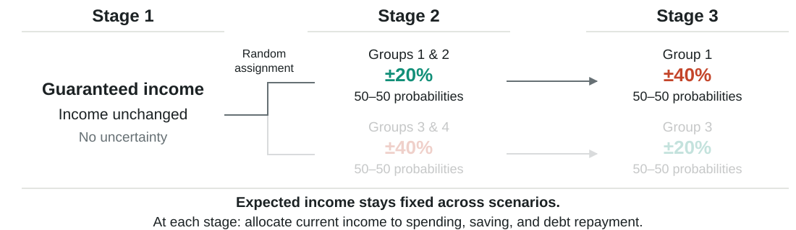{width="1100" height="320" fig-alt="Stage 1: guaranteed unchanged income. Stage 2: randomly assign groups 1 and 2 to ±20% income uncertainty and groups 3 and 4 to ±40%. Stage 3: group 1 moves to ±40% and group 3 moves to ±20%. Each spread has 50–50 probabilities; expected income stays fixed. Elicit spending, saving and debt repayment at each stage."}

::: {.notes}
The diagram shows the income-uncertainty sequences. Groups 2 and 4 proceed to the separate ambiguity component after Stage 2 and are omitted from Stage 3 here.

Within-household allocation changes measure responses to different scenarios. Path comparisons compare respondents assigned to different sequences at a common final uncertainty level; no respondent experiences both complete sequences. Scenario order and exposure also differ across paths. Outcomes are stated allocations, not observed behavior.
:::

## Findings {#findings}

::: {.prose .findings-summary .findings-grouped}
[**Main challenges · Measurement and causal identification**]{.findings-heading .main-challenges-heading}

::: {.incremental}
1. [**Do households respond to income uncertainty?**]{.finding-question}<br>
   **Yes. A substantial share of households adjust consumption, saving, and debt repayment.** [Details](#extensive){.example-button}

2. **How much do households respond?**<br>
   Relative to guaranteed income:<br>
   At ±20%: spending **−2.0%**, saving **+3.9%**, repayment **+2.6%**.<br>
   At ±40%: spending **−6.6%**, saving **+12.3%**, repayment **+7.8%**. [Details](#intensive){.example-button}

3. **How does response magnitude scale with treatment magnitude?**<br>
   Doubling uncertainty roughly **triples the average response**. [Details](#scaling){.example-button}

4. **Heterogeneity:** perceived uncertainty varies descriptively but weakly predicts response heterogeneity; income, debt, and liquidity show clearer associations. [Results](#heterogeneity-summary){.example-button} [Financial details](#heterogeneity-finances){.example-button}

:::

::: {.secondary-finding .fragment #findings-secondary}
[**Secondary challenge · Responses within the same household**]{.findings-heading .secondary-challenge-heading}

**Do households adapt? Does the path matter?**<br>
Households **adapt to the new uncertainty level**, with limited evidence of path dependence. [Comparisons](#paths){.example-button}
:::
:::


::: {.notes}
Spending and saving extensive margins are measured separately, not as a union. The intensive figures are 100 times mean log allocation-share changes, interpreted approximately as percentages and including non-adjusters. Numeric values reproduce the current chart data. Scaling ratios are imprecisely estimated. The spending path difference is −0.025 log points, approximately −2.5%. Wide confidence intervals mean failure to reject path differences is not evidence of equivalence. Allocation changes are measured within households; comparisons between paths are across randomized sequences at a common final uncertainty level. Scenario order and exposure also differ across paths. Heterogeneity results are associations, not identified causal effects of financial circumstances. Prior-uncertainty coefficients are imprecise, so these tests do not establish that differences in information perception are irrelevant. Income, liquidity and debt jointly explain only 3–4% of response variation at ±20%; many differences weaken at ±40%.
:::

## Literature and contribution {#lit}

::: {.prose .literature}
- **Precautionary saving theory**

  [@leland_saving_1968; @skinner_risky_1988; @kimball_precautionary_1990; @carroll_buffer-stock_1992; @carroll_buffer-stock_1997].
  
  [A novel vignette experiment revisits a longstanding question with changes in income uncertainty that preserve expected income.]{.primary-t}

- **Empirical precautionary saving**
  
  **Cross-sectional beliefs:** [@guiso_earnings_1992; @guiso_empirical_2002]. **Time-series and panel evidence:** [@carroll_does_1994; @carroll1994does; @carroll_how_1998; @ben-david_expectations_2018]. **Model-based analysis:** [@carroll_precautionary_2009].
  
  **Marginal propensity to consume:** [@jappelli_fiscal_2014; @fagereng_mpc_2021; @kosar_subjective_2025].

- **Perceived income uncertainty**

  [@dominitz_using_1997-2; @manski_survey_2018; @wang_perceived_2023; @caplin_subjective_2023].
  
  [Connects elicited income beliefs to experimental variation in uncertainty, including comparisons within the same household.]{.primary-t}
:::

<span class="literature-contribution"><strong>Contribution: Addresses the above challenges in one vignette experiment embedded in the German nationally representative household online panel.</strong></span>

[Back to motivation](#why-hard){.example-button} [MPC literature](#mpc-literature){.example-button} [Theory](#model){.example-button}


::: {.notes}
The first strand establishes the precautionary-saving mechanism. Skinner (1988) combines a theoretical approximation with empirical comparisons; Carroll and Samwick (1998) belongs with empirical evidence, although it also uses a model to construct uncertainty measures. Carroll, Fuhrer and Wilcox (1994) studies aggregate sentiment and spending and is not a household cross-sectional study. Guiso, Jappelli and Pistaferri (2002) studies subjective earnings and employment uncertainty rather than identifying the causal response to an uncertainty treatment. Koşar and Melcangi (2025) combines subjective uncertainty, reported MPCs and model analysis; it is the closest bridge to the MPC strand. Our allocation responses to uncertainty are not MPCs out of a transfer. The vignette identifies responses to assigned hypothetical scenarios; it does not establish effects on realized expenditure or that every respondent interprets the scenario mean identically. Wang uses perceived income uncertainty in consumption-model calibration, motivating the distinction between perceived and calibrated uncertainty. Ambiguity literature remains in the separate ambiguity section and its appendix interpretations.
:::

## How does one vignette address both challenges at once? {#design}

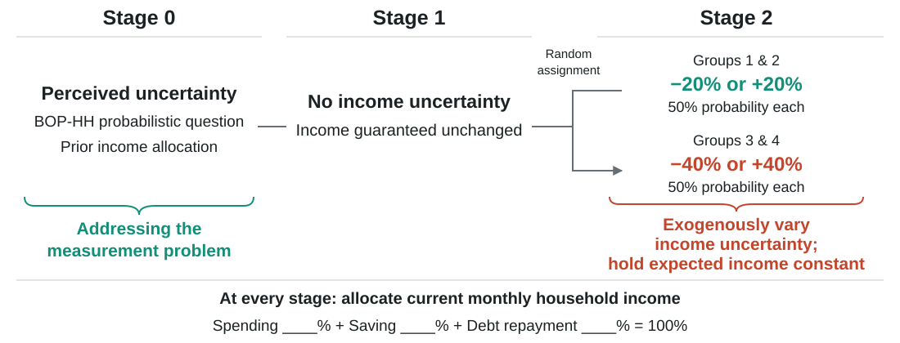{width="1200" height="458" fig-alt="Stage 0: elicit perceived income uncertainty, addressing the measurement problem. Stage 1: guaranteed unchanged income. Stage 2: random assignment to ±20% or ±40%, each with equal probabilities, exogenously varying income uncertainty while holding expected income constant."}


[Vignette example](#mean-preserving-spread){.example-button}
[Density question example](#measure){.example-button}
[Income uncertainty distribution](#income-uncertainty-distribution){.example-button}

::: {.notes}
This slide focuses on the main challenges. Stage 0 elicits perceived income uncertainty using the BOP-HH probabilistic question and records prior allocations. Stage 1 elicits allocations under guaranteed unchanged income. Stage 2 randomly assigns groups 1 and 2 to ±20% and groups 3 and 4 to ±40%, with equal probabilities of income increases and decreases. Expected income is fixed across these scenarios, but need not equal prior expected income. Allocations concern current monthly income and are stated choices. The original stage numbering is retained; estimation labels that exclude prior collection call these stages 0 and 1. Subsequent within-subject changes are shown on This paper (2/2).
:::

## Statistics Summary {#sample}

```{=html}
<div class="sample-tables">
<table><thead><tr><th>Variable</th><th>Mean</th><th>SD</th><th>N</th></tr></thead><tbody>
<tr class="sample-group"><th colspan="4">Socio-demographics</th></tr>
<tr><td>Age (years)</td><td>43.0</td><td>13.1</td><td>2,665</td></tr>
<tr><td>Male (%)</td><td>52.0</td><td>—</td><td>2,665</td></tr>
<tr><td>Bachelor’s degree or above (%)</td><td>30.7</td><td>—</td><td>2,661</td></tr>
<tr><td>Salaried (%)</td><td>73.2</td><td>—</td><td>2,258</td></tr>
<tr><td>Civil servant (%)</td><td>9.5</td><td>—</td><td>2,258</td></tr>
<tr><td>Self-employed (%)</td><td>5.4</td><td>—</td><td>2,258</td></tr>
<tr><td>Other profession (%)</td><td>11.9</td><td>—</td><td>2,258</td></tr>
<tr><td>Households with children (%)</td><td>28.5</td><td>—</td><td>2,656</td></tr>
<tr><td>Household income (€)</td><td>4,446</td><td>2,494</td><td>2,604</td></tr>
<tr><td>Personal income (€)</td><td>2,391</td><td>1,546</td><td>2,191</td></tr>
<tr class="sample-group sample-focus"><th colspan="4">Income expectations / household income</th></tr>
<tr class="sample-focus"><td>Expected income change</td><td>0.014</td><td>0.270</td><td>2,512</td></tr>
<tr class="sample-focus"><td>Income uncertainty</td><td>0.059</td><td>0.101</td><td>2,509</td></tr>
</tbody></table>
<table><thead><tr><th>Variable</th><th>Mean</th><th>SD</th><th>N</th></tr></thead><tbody>
<tr class="sample-group sample-focus"><th colspan="4">Expenditure and saving</th></tr>
<tr><td>Durable purchases (%)</td><td>43.6</td><td>—</td><td>1,424</td></tr>
<tr><td>Durables: intensive margin (€)</td><td>1,718</td><td>6,125</td><td>655</td></tr>
<tr class="sample-focus"><td>Non-durables: intensive margin (€)</td><td>1,312</td><td>2,650</td><td>1,401</td></tr>
<tr><td>Housing expenditure (€)</td><td>892</td><td>1,679</td><td>1,422</td></tr>
<tr class="sample-focus"><td>Saving participation (%)</td><td>74.5</td><td>—</td><td>1,420</td></tr>
<tr class="sample-focus"><td>Saving: intensive margin (€)</td><td>735</td><td>2,505</td><td>1,097</td></tr>
<tr class="sample-group sample-focus"><th colspan="4">Financial conditions · debt</th></tr>
<tr><td>Net wealth (€1,000)</td><td>301.8</td><td>423.9</td><td>2,546</td></tr>
<tr><td>Homeownership (%)</td><td>59.3</td><td>—</td><td>2,662</td></tr>
<tr><td>Liquidity-to-income ratio</td><td>15.904</td><td>30.452</td><td>2,448</td></tr>
<tr class="sample-focus"><td>Total debt (€)</td><td>66,401</td><td>135,141</td><td>2,600</td></tr>
<tr class="sample-focus"><td>Debt-to-income ratio</td><td>13.545</td><td>29.086</td><td>2,481</td></tr>
<tr class="sample-focus"><td>Unsecured debt (%)</td><td>26.4</td><td>—</td><td>2,610</td></tr>
<tr class="sample-focus"><td>Unsecured debt: intensive (€)</td><td>18,389</td><td>25,431</td><td>709</td></tr>
<tr class="sample-focus"><td>Secured debt (%)</td><td>35.0</td><td>—</td><td>2,603</td></tr>
<tr class="sample-focus"><td>Secured debt: intensive (€)</td><td>175,711</td><td>174,237</td><td>1,061</td></tr>
<tr><td>Cash on hand (€)</td><td>73,072</td><td>135,318</td><td>2,533</td></tr>
</tbody></table>
</div>
```

[Weighted statistics; N is the unweighted number of observations available for each variable. Income expectations are divided by household income and shown as ratios. — = not reported.]{.figcap}

[Back to this paper](#panel){.example-button}

::: {.notes}
Source: updated summary-statistics table supplied by the author. Values rounded from the supplied table. Only normalized income expectations are displayed; euro-denominated expectation measures are omitted. Weighted N and distribution percentiles are omitted for readability. The earlier statement that belief moments are available for only 841 respondents has been removed because the updated table reports N = 2,512 and 2,509 for the normalized expectation measures. Liquidity-to-income and debt-to-income retain the source's ratio units, without adding a percent label.
:::


## Compared with no income uncertainty… {#uncertainty-response .divider .center}

When households are told income uncertainty will increase, [**on average**]{.average-emphasis}, they say they would…

## Do households respond to income uncertainty? {#extensive .margin-results}

```{=html}
<div class="stage" data-chart="extensiveUpdated"></div>
```

::: {.extensive-note .figcap}
Changes relative to guaranteed income. Consumption and saving are measured separately; debt repayment covers pre-treatment debtors only. Unweighted.
:::

::: {.extensive-summary}
- **Yes. A substantial share of households responds to income uncertainty.**

  - **At ±20%:** around 50% of households adjust consumption and saving; 23% of debtors adjust debt repayment.
  - **At ±40%:** around 60% of households adjust consumption and saving; 34% of debtors adjust debt repayment.
:::


::: {.extensive-links}
[Debt adjustment direction](#adjustment-direction){.example-button}
[Debt composition among adjusters](#debt-composition-adjusters){.example-button}
:::

::: {.notes}
The headline reports adjustment rates for spending, saving and debt repayment separately, not the fraction changing any component of the overall allocation. At ±20%, 46.6% adjust spending and 48.0% adjust saving. At ±40%, the corresponding shares are 60.9% and 61.4%. Among pre-treatment debtors, debt repayment adjusts for 23.4% (112/479) and 34.0% (162/476), respectively. Spending and saving use all valid paired responses: N = 961 at ±20% and N = 938 at ±40%. Results are unweighted. These are stated allocations under hypothetical scenarios. The first-stage comparison includes all four groups and holds expected income in the scenario fixed.
:::

## How much do households adjust in response to income uncertainty? {#intensive .margin-results}

[**Households say they would cut current spending, save more and repay debt faster.**]{.result-answer}

```{=html}
<div class="stage" data-chart="intensive"></div>
```

[Approximate percentage changes in allocation shares relative to no income uncertainty, including non-adjusters. Labels show channel-specific observations: both guaranteed-stage and uncertainty-stage allocations must be observed and positive. Points show estimates; whiskers show 95% confidence intervals. ±20% uses a dashed pattern; ±40% uses a solid fill.]{.source}

[Full estimates table](#intensive-table){.example-button} [Common sample results](#intensive-common){.example-button} [Illustrative euro amounts](#lena-budget){.example-button} [Robustness](#robust1){.example-button} [Debt-type repayment results](#hetero-debt){.example-button}

::: {.notes}
The supplied estimates are not conditional on adjustment: the intensive sample sizes are 960 and 938, versus spending-adjuster counts of 448 and 571. Do not label these estimates as conditional on adjustment. A conditional analysis would require the corresponding estimates and standard errors from respondent data or the relevant table. Numbers are 100 times mean log-share changes, interpreted approximately as percentage changes in allocation shares relative to no income uncertainty, not percentage-point changes. Stage 2 is the first uncertainty and Stage 1 the guarantee in the presentation's numbering. The original estimation labels these stages 1 and 0. Treatment of zero allocation shares should be checked against the paper before presenting log estimates.
:::

## How does response magnitude scale with treatment magnitude? {#scaling}

[**Doubling income uncertainty roughly triples the estimated response.**]{.result-answer}

:::: {.scaling-layout}
::: {.stats .scaling-ratios}
::: {.stat}
[[]{.data key="intensive.rows.0.ratio" d="1"}×]{.k .f}
[Consumption]{.l}
:::
::: {.stat}
[[]{.data key="intensive.rows.1.ratio" d="1"}×]{.k .f}
[Saving]{.l}
:::
::: {.stat}
[[]{.data key="intensive.rows.2.ratio" d="1"}×]{.k .f}
[Debt repayment]{.l}
:::
:::

```{=html}
<div class="stage" data-chart="scaling"></div>
```
::::

[Illustrative benchmarks and estimates with 95% confidence intervals. The intervals include both proportional and quadratic scaling.]{.source}

[Model](#model){.example-button}

::: {.notes}
The figure compares the ±40% response with the ±20% response. Curves illustrate linear and quadratic benchmarks, not fitted response functions. Whiskers are delta-method 95% confidence intervals treating the treatment groups as independent. The point estimates suggest more-than-proportional responses, but the intervals include both the 2× and 4× benchmarks. The exact degree of nonlinearity is uncertain.
:::


## Not all households respond like the average household {#heterogeneity-divider}

```{=html}
<div class="heterogeneity-setup">
  <div class="heterogeneity-hypotheses">
    <h3 class="heterogeneity-title">Not all households respond like the average household</h3>
    <div><h3>H1</h3><p>Responses vary with endogenous perceived income uncertainty.</p></div>
    <div><h3>H2</h3><p>Responses vary with financial balance sheet strength.</p></div>
  </div>
  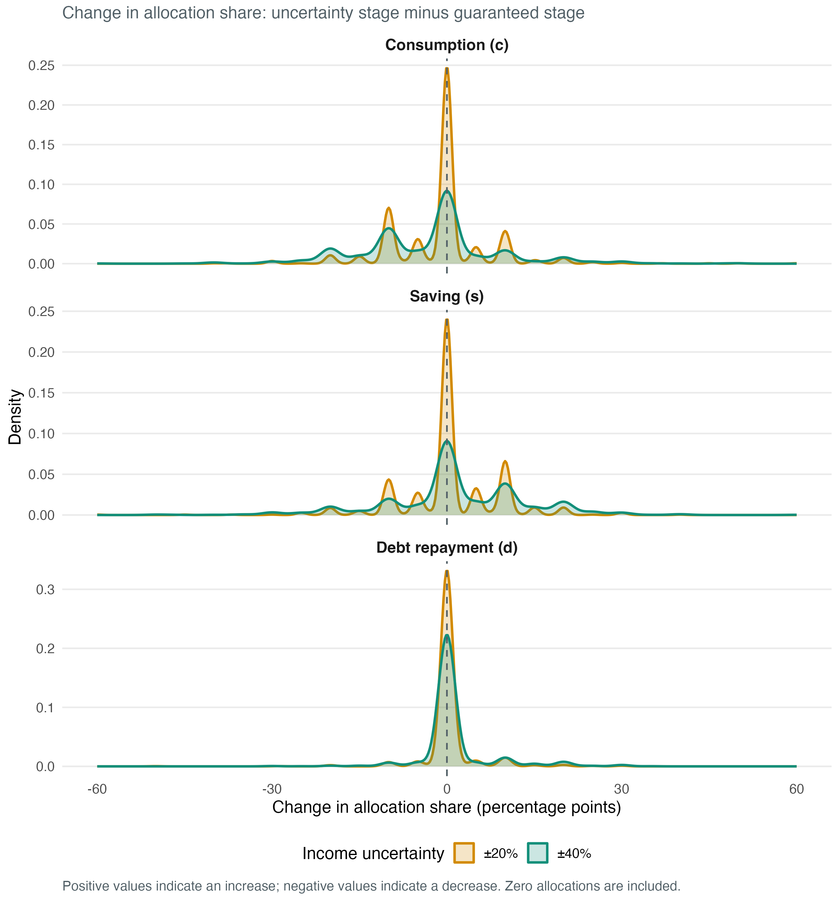
</div>
```

## H1: Does endogenous perceived income uncertainty predict adjustment heterogeneity? {#heterogeneity-summary}

```{=html}
<div class="endogenous-heterogeneity-layout">
  <div class="endogenous-heterogeneity-figure">
    <h3>Descriptive responses under ±20% uncertainty</h3>
    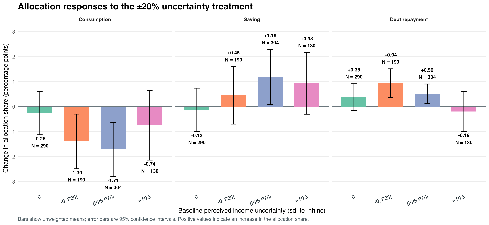
    <p>Responses vary across perceived-uncertainty groups. This figure is descriptive.</p>
  </div>
  <div class="endogenous-heterogeneity-results">
    <h3>Prediction regression</h3>
    <p class="heterogeneity-equation">Δ allocation<sub>pp</sub> = α<sub>u,o</sub> + β<sub>L</sub>Low + β<sub>M</sub>Middle + β<sub>H</sub>High + ε</p>
    <p class="heterogeneity-spec">Estimated separately by uncertainty treatment (u) and outcome (o); zero perceived uncertainty is the reference group. HC2 robust standard errors.</p>
    <table class="uncertainty-prediction-table">
      <thead><tr><th>Treatment</th><th>Outcome</th><th>Zero mean</th><th>Low Δ (p)</th><th>Middle Δ (p)</th><th>High Δ (p)</th></tr></thead>
      <tbody>
        <tr><td>±20%</td><td>Consumption</td><td>−0.259</td><td>−1.240 (.077)</td><td>−1.370 (.055)</td><td>−0.512 (.536)</td></tr>
        <tr><td>±20%</td><td>Saving</td><td>−0.124</td><td>+0.682 (.342)</td><td>+1.270 (.079)</td><td>+1.060 (.164)</td></tr>
        <tr><td>±20%</td><td>Debt repayment</td><td>+0.383</td><td>+0.562 (.152)</td><td>+0.104 (.759)</td><td>−0.543 (.262)</td></tr>
        <tr><td>±40%</td><td>Consumption</td><td>−2.900</td><td>+0.585 (.602)</td><td>−0.888 (.365)</td><td>+0.228 (.873)</td></tr>
        <tr><td>±40%</td><td>Saving</td><td>+1.660</td><td>−0.332 (.777)</td><td>+0.507 (.615)</td><td>−0.384 (.779)</td></tr>
        <tr><td>±40%</td><td>Debt repayment</td><td>+1.240</td><td>−0.253 (.663)</td><td>+0.381 (.484)</td><td>+0.155 (.787)</td></tr>
      </tbody>
    </table>
    <p class="uncertainty-prediction-note">Zero mean is the predicted change for sd_to_hhinc = 0. Other cells give coefficient differences from zero (p-value); predicted group mean = zero mean + difference. N = 914 at ±20%; N = 907 at ±40%.</p>
  </div>
</div>
<p class="endogenous-heterogeneity-takeaway">Descriptively, responses vary across endogenous perceived-uncertainty groups; in regression, those differences have little predictive power.</p>
```

::: {.notes}
The descriptive figure groups respondents by baseline endogenous perceived income uncertainty and plots unweighted mean within-household changes under the ±20% treatment. The regression uses the same uncertainty groups, with sd_to_hhinc = 0 as the reference and four categories: zero, positive through P25, P25–P75, and above P75 of positive perceived uncertainty. The code estimates separate OLS regressions by outcome and treatment, with HC2 heteroskedasticity-robust standard errors. The table reports the zero-group intercept and contrasts for the other groups; p-values test each contrast against zero. It does not report a joint test of all group coefficients, so weak individual prediction should not be read as proof that all groups respond equivalently.
:::

## H2: Household financial strength explains differences in adjustment {#heterogeneity-finances}

::: {.prose .heterogeneity-summary}
- **Income:** Higher income shapes consumption and saving mainly under smaller shocks (±20%). [Income](#hetero-income){.example-button}

- **Liquidity:**
  - High-liquidity households begin adjusting under larger shocks (±40%).
  - Under ±40%, middle- and high-liquidity borrowers are less likely than low-liquidity borrowers to increase repayment. [Liquidity](#hetero-liquidity){.example-button}

- **Debt repayment:**
  - **Debt type:** Under ±20%, households with consumer debt are more likely to raise repayments; under ±40%, mortgage holders are more likely to do so. [Debt type](#hetero-debt){.example-button}
  - **Existing debt burden:** Lower-burden households increase repayments more; higher-burden households repay less and save more. [Debt burden](#repayment-burden){.example-button}

:::

[Relative explanatory contributions](#hetero-shapley){.example-button}

::: {.notes}
First-treatment regressions use approximately 819 respondents at ±20% and 807 at ±40%, controlling for socio-demographics and guaranteed-income allocation, with HC3 standard errors. Income, liquidity and debt are not randomized. Shapley percentages describe shares of the variation explained by these three dimensions, not shares of all outcome variation. Do not describe ±40% responses as universal: the extensive-margin evidence shows about 61% adjusting spending or saving, measured separately.
:::


## Addressing the secondary challenge {.divider .center}

**A within-subject design**

How does the same household adapt to changes in income uncertainty?

```{=html}
<div class="stage glyph" data-chart="fork" data-state="two"></div>
```

## Households adapt to a new uncertainty level {#uncertainty-adaptation}

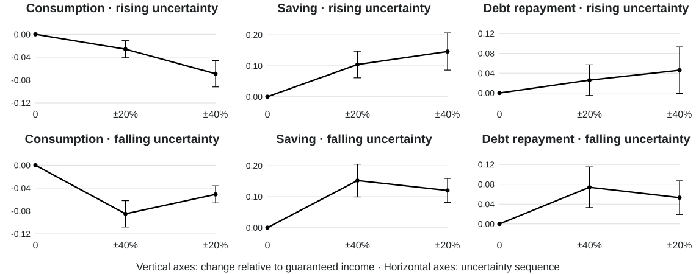{width="1140" height="450" fig-alt="Six panels show observed consumption, saving and debt repayment as uncertainty rises from zero to ±20% to ±40%, or falls from ±40% to ±20%. Only black solid observed series and their error bars are shown."}

[Observed series only. Approximate reconstruction from the supplied figure; error bars reproduced from that figure.]{.source}

::: {.notes}
The plotted positions and interval endpoints are approximate readings from the user-supplied Figure 6 screenshot, not newly estimated results. The screenshot differs from the existing path-comparison table, particularly for saving, so its trajectories are not silently replaced with table coefficients. Blue linear-scaling and red CRRA benchmarks are omitted. The guaranteed-income baseline is zero. Rows show rising and falling uncertainty, respectively; columns show consumption, saving and repayment.
:::

## Does the intermediate uncertainty level matter? {#design-swap}

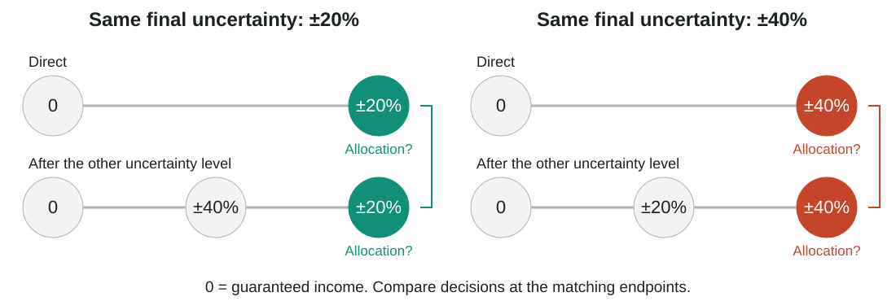{width="1100" height="370" fig-alt="Two matched comparisons. At final ±20% uncertainty, compare group 1 facing it directly with group 3 reaching it after ±40%. At final ±40%, compare group 3 facing it directly with group 1 reaching it after ±20%. All allocations are measured relative to guaranteed income."}

[**Same final uncertainty. Different uncertainty experience. Different allocation?**]{.slide-takeaway}

::: {.notes}
These are comparisons across randomized sequences at a common final uncertainty level. Each respondent follows only one sequence. Outcomes are within-household changes from guaranteed income. History comparisons also differ in scenario order and exposure, so they do not isolate a psychological mechanism. There is no additional Stage 0 diagram here because the survey design has already been shown.
:::

## Mostly, only the final uncertainty level matters {#paths}

```{=html}
<div class="path-tables"><div><h3>Final ±40%: 0 → 40 vs. 0 → 20 → 40</h3><table class="standard-results"><thead><tr><th>Outcome</th><th>Direct</th><th>After other uncertainty level</th><th>Difference</th></tr></thead><tbody><tr class="estimate-row"><th>Spending</th><td>−0.084***</td><td>−0.069***</td><td>0.015</td></tr><tr><th>SE</th><td>0.012</td><td>0.012</td><td>0.017</td></tr><tr><th>p-value</th><td><0.001</td><td><0.001</td><td>0.357</td></tr><tr><th>Observations</th><td>479</td><td>446</td><td>—</td></tr><tr class="estimate-row"><th>Saving</th><td>0.151***</td><td>0.151***</td><td>−0.000</td></tr><tr><th>SE</th><td>0.027</td><td>0.031</td><td>0.041</td></tr><tr><th>p-value</th><td><0.001</td><td><0.001</td><td>0.998</td></tr><tr><th>Observations</th><td>407</td><td>363</td><td>—</td></tr><tr class="estimate-row"><th>Debt repayment</th><td>0.074***</td><td>0.046*</td><td>−0.028</td></tr><tr><th>SE</th><td>0.021</td><td>0.024</td><td>0.032</td></tr><tr><th>p-value</th><td><0.001</td><td>0.060</td><td>0.382</td></tr><tr><th>Observations</th><td>233</td><td>219</td><td>—</td></tr></tbody></table></div><div><h3>Final ±20%: 0 → 20 vs. 0 → 40 → 20</h3><table class="standard-results"><thead><tr><th>Outcome</th><th>Direct</th><th>After other uncertainty level</th><th>Difference</th></tr></thead><tbody><tr class="estimate-row"><th>Spending</th><td>−0.026***</td><td>−0.051***</td><td>−0.025**</td></tr><tr><th>SE</th><td>0.007</td><td>0.008</td><td>0.011</td></tr><tr><th>p-value</th><td>0.001</td><td><0.001</td><td>0.018</td></tr><tr><th>Observations</th><td>474</td><td>473</td><td>—</td></tr><tr class="estimate-row"><th>Saving</th><td>0.076***</td><td>0.096***</td><td>0.019</td></tr><tr><th>SE</th><td>0.022</td><td>0.020</td><td>0.029</td></tr><tr><th>p-value</th><td><0.001</td><td><0.001</td><td>0.504</td></tr><tr><th>Observations</th><td>408</td><td>424</td><td>—</td></tr><tr class="estimate-row"><th>Debt repayment</th><td>0.024</td><td>0.049***</td><td>0.025</td></tr><tr><th>SE</th><td>0.015</td><td>0.018</td><td>0.023</td></tr><tr><th>p-value</th><td>0.104</td><td>0.005</td><td>0.277</td></tr><tr><th>Observations</th><td>233</td><td>227</td><td>—</td></tr></tbody></table></div></div>
```

[**Exception: spending at ±20% remains lower after ±40% (difference −0.025, p = 0.018).**]{.slide-takeaway}

[Log allocation changes relative to guaranteed income (0). Difference = after the other uncertainty level minus direct. SE = standard error. * p < 0.10, ** p < 0.05, *** p < 0.01. Insignificance does not establish equivalence.]{.source}

::: {.notes}
Tables transcribed from the user-supplied results. Each response is a within-household change; comparisons between paths are across randomized sequences. The difference column reports the supplied estimates, which need not equal differences of rounded coefficients. Scenario order and exposure also differ across paths.
:::


## Households DO respond to perceived income uncertainty {#conclusion}

::: {.prose .findings-summary .findings-grouped}
[**Main findings · Household responses**]{.findings-heading .main-challenges-heading}

::: {.incremental}
1. [**Do households respond to income uncertainty?**]{.finding-question}<br>
   **Yes. A substantial share adjusts consumption, saving, and debt repayment.**

2. **How much do households respond?**<br>
   At ±20%: spending **−2.0%**, saving **+3.9%**, repayment **+2.6%**.<br>
   At ±40%: spending **−6.6%**, saving **+12.3%**, repayment **+7.8%**.

3. **Heterogeneity:** income matters mainly for consumption and saving under ±20%; liquidity differences emerge under ±40%; debt type predicts repayment increases.
:::

::: {.secondary-finding .fragment}
[**Secondary challenge · Responses within the same household**]{.findings-heading .secondary-challenge-heading}

Households **adapt to the new uncertainty level**, with limited evidence of path dependence. Spending remains lower at ±20% when households first faced ±40%.
:::
:::

[Backup: ambiguity (Knightian uncertainty)](#ambiguity-backup){.example-button}

::: {.notes}
Allocation responses are relative to the guaranteed-income scenario. The heterogeneity patterns are associations, not causal effects of income, liquidity, or debt. The within-household path comparisons are across randomized sequences, not both paths experienced by each respondent.
:::


## Income uncertainty matters! {#closing .closing}

**Thank you.**

```{=html}
<div class="closing-contact">
  <div class="closing-contact-details">
    <strong>Xiaoting (Jasmine) Chen</strong><br>
    <a href="mailto:chen@safe-frankfurt.de">chen@safe-frankfurt.de</a>
  </div>
  <div class="closing-qr-wrap">
    <a href="https://jasminechenxiaoting.github.io" target="_blank" rel="noopener" aria-label="Visit Xiaoting Chen’s website">
      
    </a>
    <span>Scan or click to visit my website</span>
  </div>
</div>
```

## Appendix {.divider .center visibility="uncounted"}

## Intensive margin estimates {#intensive-table visibility="uncounted"}

Detailed estimates of allocation-share changes relative to guaranteed income. Standard errors are in parentheses; paired R is the correlation between log allocations.

<div><table class="standard-results"><thead><tr><th></th><th>Spending</th><th>Saving</th><th>Debt repayment</th></tr></thead><tbody><tr><th>A. ±20% uncertainty</th><td></td><td></td><td></td></tr><tr class="estimate-row"><th>% change in allocation shares</th><td>−2.0***</td><td>3.9***</td><td>2.6**</td></tr><tr><th>Standard error</th><td>(0.5)</td><td>(1.5)</td><td>(1.1)</td></tr><tr><th>Paired R</th><td>0.897</td><td>0.810</td><td>0.943</td></tr><tr><th>Paired R²</th><td>0.804</td><td>0.655</td><td>0.889</td></tr><tr><th>Observations</th><td>960</td><td>837</td><td>489</td></tr><tr><th>B. ±40% uncertainty</th><td></td><td></td><td></td></tr><tr class="estimate-row"><th>% change in allocation shares</th><td>−6.6***</td><td>12.3***</td><td>7.8***</td></tr><tr><th>Standard error</th><td>(0.8)</td><td>(1.9)</td><td>(1.5)</td></tr><tr><th>Paired R</th><td>0.809</td><td>0.715</td><td>0.897</td></tr><tr><th>Paired R²</th><td>0.654</td><td>0.511</td><td>0.804</td></tr><tr><th>Observations</th><td>938</td><td>790</td><td>469</td></tr></tbody></table></div>

[Back to adjustment magnitudes](#intensive){.example-button onclick="Reveal.slide(Reveal.getIndices(document.getElementById('intensive')).h, Reveal.getIndices(document.getElementById('intensive')).v); return false;"}

## Common-sample adjustment magnitudes {#intensive-common visibility="uncounted"}

```{=html}
<div class="stage" data-chart="intensiveCommon"></div>
```

[Back to adjustment magnitudes](#intensive){.example-button onclick="Reveal.slide(Reveal.getIndices(document.getElementById('intensive')).h, Reveal.getIndices(document.getElementById('intensive')).v); return false;"}


## Distribution of perceived income uncertainty {#income-uncertainty-distribution visibility="uncounted"}

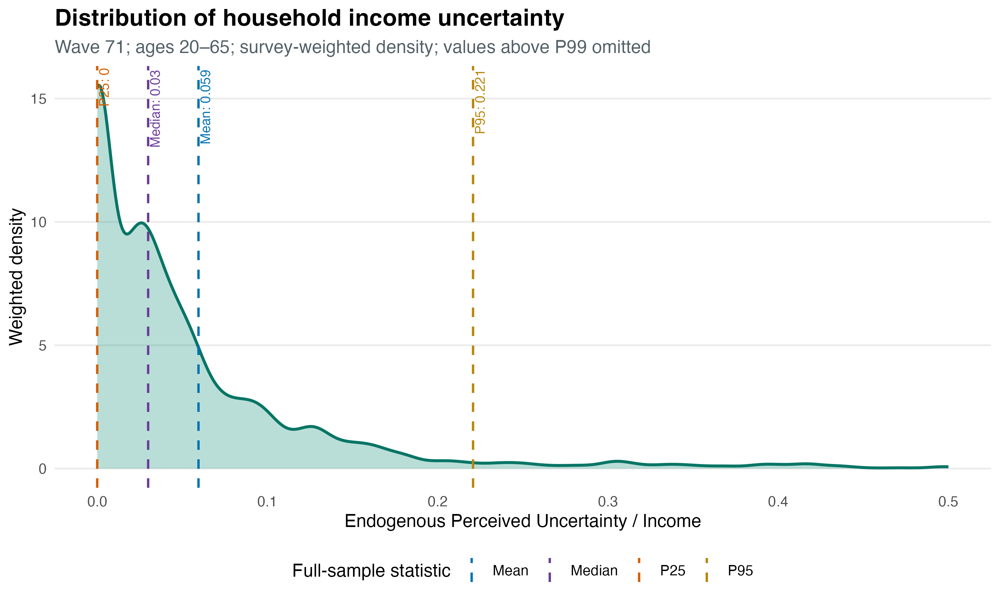{width="1100" height="660" fig-alt="Survey-weighted distribution of perceived household income uncertainty relative to household income in wave 71 among respondents aged 20–65. Values above the 99th percentile are omitted. The mean is 0.059, median 0.03, 25th percentile 0, and 95th percentile 0.221."}

[Back to Main challenges](#design){.example-button onclick="Reveal.slide(Reveal.getIndices(document.getElementById('design')).h, Reveal.getIndices(document.getElementById('design')).v); return false;"}

## Direction of adjustment {#adjustment-direction visibility="uncounted"}

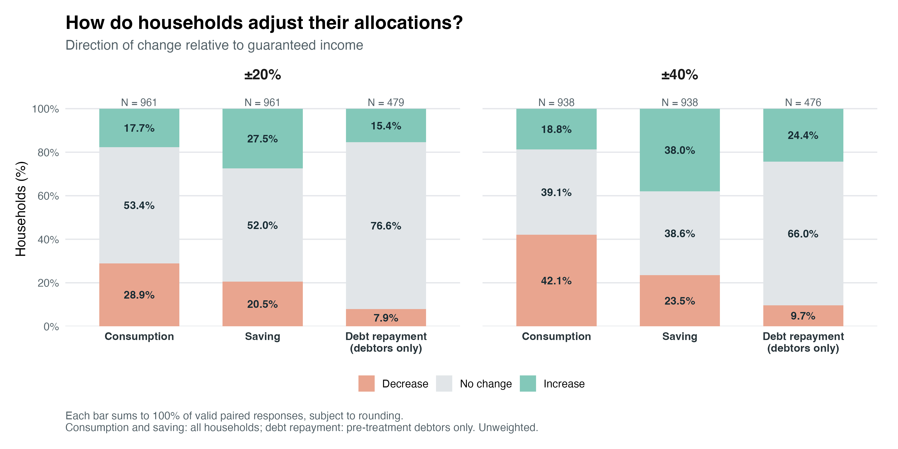{width="1100" height="550" fig-alt="Direction of allocation changes relative to guaranteed income. At ±20%, decrease / no change / increase: consumption 28.9 / 53.4 / 17.7 percent; saving 20.5 / 52.0 / 27.5 percent; debt repayment 7.9 / 76.6 / 15.4 percent. At ±40%: consumption 42.1 / 39.1 / 18.8 percent; saving 23.5 / 38.6 / 38.0 percent; debt repayment 9.7 / 66.0 / 24.4 percent. Debt repayment covers pre-treatment debtors only. Unweighted."}

[Back to household adjustment](#extensive){.example-button onclick="Reveal.slide(Reveal.getIndices(document.getElementById('extensive')).h, Reveal.getIndices(document.getElementById('extensive')).v); return false;"}

## Debt composition among repayment adjusters {#debt-composition-adjusters visibility="uncounted"}

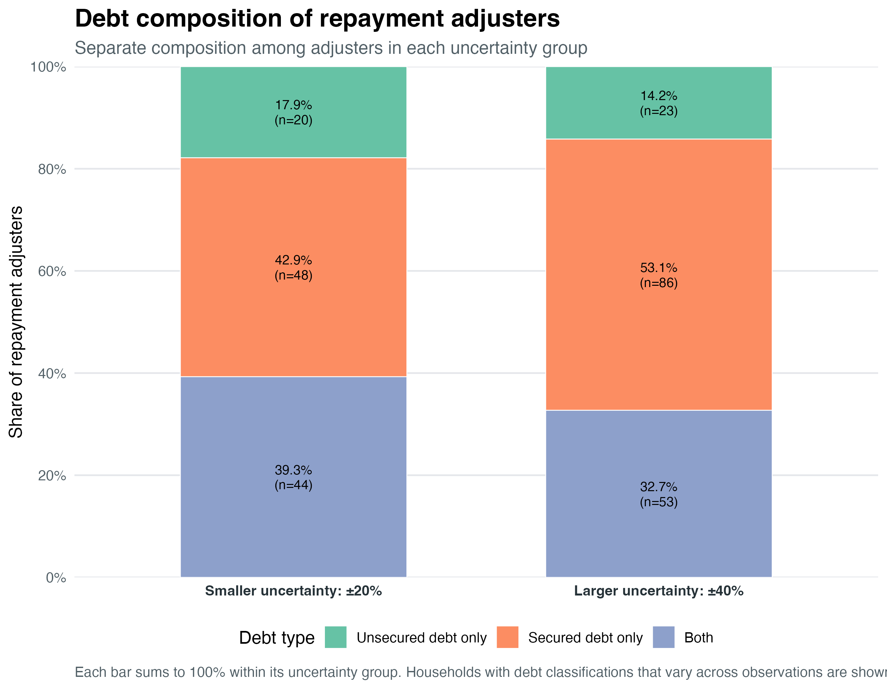{width="1100" height="856" fig-alt="Composition of debt types among households that adjusted debt repayment. At ±20% uncertainty, 39.3% had both secured and unsecured debt, 42.9% had secured debt only, and 17.9% had unsecured debt only. At ±40%, the shares were 32.7%, 53.1%, and 14.2%, respectively."}

[Back to household adjustment](#extensive){.example-button onclick="Reveal.slide(Reveal.getIndices(document.getElementById('extensive')).h, Reveal.getIndices(document.getElementById('extensive')).v); return false;"}


```{=html}
<div class="stage glyph" data-chart="fork" data-state="quiet"></div>
```

## Challenge 1: perceived uncertainty, not realized income {#income-uncertainty-example visibility="uncounted"}

[Measure households’ **perceived uncertainty about future income**.]{.slide-takeaway}

[Related literature: @dominitz_using_1997-2; @wang_perceived_2023.]{.source}

[Back to Motivation](#why-hard){.example-button}

::: {.notes}
The distinction here is measurement, not identification of the mean versus the uncertainty. Realized income histories can inform a calibrated income process, but need not capture the uncertainty a household currently perceives about future income. Ask households for their subjective probabilities. The figure is schematic and imposes no comparison of means.
:::

## Challenge 2: Perceived income uncertainty co-moves with expected income changes in existing survey data {#remaining-challenges visibility="uncounted"}

[]{#income-moments-example}

::: {.prose}
[Manipulate **income uncertainty** while holding **expected income unchanged**.]{.slide-takeaway}
:::

[Schematic illustration of probabilistic survey answers. The mean and uncertainty both change.]{.source}

[Back to Motivation](#why-hard){.example-button}

::: {.notes}
Compare Jasmine's reported income distributions in two survey waves. Both the mean and the uncertainty change, and she reports planning to reduce current consumption. This joint observation alone does not identify the separate effect of uncertainty. The illustration shows a falling mean and a rising variance; co-movement need not be positive. Strictly, the second central moment is the variance, while the standard deviation is its square root. The curves schematically represent answers to a probabilistic income question. They illustrate a lower mean and higher uncertainty in the second wave, without assigning numerical probabilities or income values. They are not fitted distributions or survey estimates. Dashed vertical lines mark the two means. Observational identification requires additional assumptions or exogenous variation. The experiment varies the uncertainty while holding the scenario mean fixed.
:::

## Challenge 3: the same household under different uncertainty {#identification-challenge visibility="uncounted"}

[]{#causal-path-example}

::: {.split .even .cols}
::: {.prose}
[Lower income uncertainty]{.colhead}

How would this household allocate its current income?
:::
::: {.prose}
[Higher income uncertainty]{.colhead}

How would **the same household** change its allocation?
:::
:::

[How do the **SAME household’s decisions** change when income uncertainty changes?]{.slide-takeaway}

[Back to Motivation](#why-hard){.example-button}

::: {.notes}
This slide motivates a within-subject comparison without repeating the survey flow. Randomized scenario sequences support identification, while comparing the same household removes time-invariant household differences. Repeated observations alone do not establish causality. Path dependence is introduced later as a separate question about the same final uncertainty level reached through different histories.
:::

## Backup · Ambiguity (Knightian uncertainty) {#ambiguity-backup .divider .fog visibility="uncounted"}

```{=html}
<div class="stage glyph" data-chart="coin" data-mode="fog"></div>
```

[Back to conclusion](#conclusion){.example-button}

::: {.notes}
Households in group 2 face the same ±20 spread, and then one sentence changes. The probability of each outcome is unknown.
:::

## Survey flow: ambiguity {#design-ambiguity visibility="uncounted"}

```{=html}
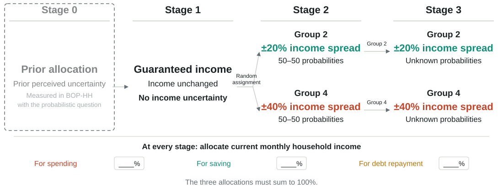
```

::: {.prose}
[Hold the income spread fixed; change probabilities from **50–50** to **unknown**.]{.slide-takeaway}

[Theoretical interpretations](#readings){.example-button} [Stated preferences](#preferences){.example-button}
:::

[Back to conclusion](#conclusion){.example-button}

::: {.notes}
This is a separate experimental component. Group 2 faces ±20 throughout; group 4 faces ±40 throughout. Stage 2 gives equal probabilities; Stage 3 leaves them unspecified, following the presentation numbering that includes prior collection. Unlike the known-probability spread comparison, withdrawing probabilities does not specify a mathematical expectation, so do not describe it as a mean-preserving spread. Compare stated allocations before and after probabilities are withdrawn. The uncertainty path comparisons used groups 1 and 3, while these ambiguity comparisons use groups 2 and 4.
:::

## On average, withdrawing the probability changes nothing {#ambiguity visibility="uncounted"}

::: {.split}
::: {.prose}
At ±40, the spending share fell by about [[]{.data key="ambiguity.s40.spend.known" d="1" mul="100" abs="1"}]{.num .primary-t} percent with known odds. Withdrawing the odds moves it by [[]{.data key="ambiguity.s40.spend.fog" d="1" mul="100" abs="1"}]{.num .actor-b-t} percent more, indistinguishable from zero.

The six blue bars, every outcome at both spreads, sit on the zero line.

Known probabilities and unknown probabilities produce the same budget, on average.

[Within-subject Δ log share, groups 2 and 4, 95% intervals. Table *From known to unknown probabilities*.]{.source}
:::
```{=html}
<div class="stage" data-chart="ambiguity" data-animate="once"></div>
```
:::

[Back to conclusion](#conclusion){.example-button}

::: {.notes}
The coloured bars build first, then the blue ones, which are the payoff: six bars that barely leave zero. Let the silence do the work. Two honest notes if asked: these are groups 2 and 4 only, and their stage-1 responses are smaller than groups 1 and 3's, which is a between-arm difference worth discussing. And the contrast that makes "nothing" meaningful: the swap groups, at the same second stage, did move when the spread changed. Then the natural objection: "nothing on average can hide a lot". Agreed, and the next two slides take the average apart.
:::

## Three in four households enter exactly the same three numbers {#retain visibility="uncounted"}

::: {.stack}
::: {.prose}
Between 75 and 87 percent of respondents keep their split to the point when the odds are withdrawn. With the same reminder on screen at stage 1, between 47 and 61 percent had changed it when a spread arrived. The reminder makes "no change" easy. It does not make it automatic.
:::
```{=html}
<div class="stage" data-chart="retain"></div>
```
:::

[Back to conclusion](#conclusion){.example-button}

::: {.notes}
Grey is the no-change share. The comparison that separates inertia from retained beliefs is on this slide: the same form, with the same reminder, produced change in half the sample when the spread moved, and in a quarter when only the odds disappeared. Both readings in column two survive; what does not survive is reading one. The remaining quarter is the next slide.
:::

## Among those who move, the two directions cancel {#tug visibility="uncounted"}

::: {.stack}
::: {.prose}
The quarter who adjust do not move one way. For every outcome and both spreads, the households who increase and the households who decrease contribute nearly equal and opposite amounts, and the net is the zero of two slides back. The moves themselves are not small: a mover changes their share by roughly 20 percent for spending and 50 percent for saving.
:::
```{=html}
<div class="stage" data-chart="tug"></div>
```
:::

[Back to conclusion](#conclusion){.example-button}

::: {.notes}
Solid up, hatched down, the black tick is the sum. The per-mover size is the contribution divided by the share: 0.064 / 0.129 is about 0.5 log points for saving increasers at ±20, 0.019 / 0.084 about 0.2 for spending. So "ambiguity plays no role" is wrong as a statement about households and right as a statement about the average. Who moves which way lines up with prior income perception, which is the next step in the heterogeneity work.
:::

## For Jasmine, ±40 percent means about €200 less spending a month {#lena-budget visibility="uncounted"}

::: {.stack}
::: {.prose}
Jasmine's monthly income is €4,500 and she splits it 70 / 20 / 10. Apply the estimates. At ±40 percent she spends about **€200 less** a month, puts about **€120 more** into savings and about **€37 more** into debt. The mean of her income has not moved by a euro.

[Stylised level, measured slopes. The 70 / 20 / 10 split is illustrative; the panel's median prior split is 70 / 20 / 5 ([prior allocations](#prior)). Each category moves by its own estimated log change, so the three moves need not sum to zero.]{.source}
:::
```{=html}
<div class="stage" data-chart="budget"></div>
```
:::

[Back to intensive margin](#intensive){.example-button}

::: {.notes}
The bar opens at ±40, the state the title claims. Click "Guaranteed" to show where she started, then ±20, then back to ±40. The dashed ticks mark the guaranteed-income split. Say the euro numbers, not the log points. If asked why the three moves do not net to zero: each is the mean of a separate log change, and means of log changes do not respect an individual budget constraint; the euro translation is an illustration of magnitude, not an accounting identity.
:::

## BOP-HH probabilistic question on income expectations {#measure visibility="uncounted"}

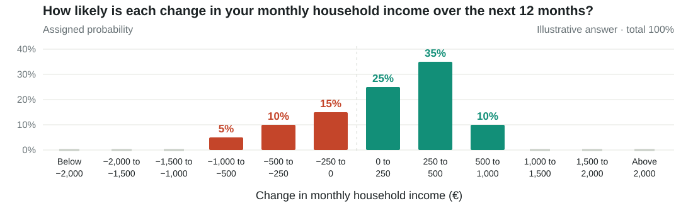{.income-question-chart width="1100" height="330" fig-alt="Illustrative probabilistic income answer using the survey's income-change bins. Assigned probabilities sum to 100 percent and describe both expected income growth and perceived income uncertainty."}

::: {.split .even .income-moments}
::: {.prose}
**Perceived income growth**

$$\mu_{i,t}=\frac{\mathbb{E}_{i,t}[\Delta y_{i,t+1}]}{y_{i,t}}$$

Mean of the elicited distribution, relative to current income.
:::
::: {.prose}
**Perceived income uncertainty**

$$\sigma_{i,t}=\frac{\sqrt{\operatorname{Var}_{i,t}(\Delta y_{i,t+1})}}{y_{i,t}}$$

Standard deviation of the elicited distribution, relative to current income.
:::
:::

[Back to This paper](#panel){.example-button}
[Back to Main challenges](#design){.example-button onclick="Reveal.slide(Reveal.getIndices(document.getElementById('design')).h, Reveal.getIndices(document.getElementById('design')).v); return false;"}


[One probabilistic answer measures both expected income growth and perceived uncertainty.]{.slide-takeaway}

::: {.notes}
The question at the top of the figure is a paraphrase. The chart uses the same twelve euro income-change bins as the original appendix graphic, with a deliberately illustrative answer rather than respondent data. Probabilities sum to 100 percent. Both moments come from the same subjective distribution over monthly household income changes twelve months ahead. The expectation and variance notation summarizes the measurement; implementing these moments from bins requires choices for representative outcomes within each bin, including the open-ended tails. Current income is known, so the variance of future income equals the variance of its change. The formulas preserve the normalization by current household income used elsewhere in the presentation.
:::

## Mean-preserving income spreads {#mean-preserving-spread visibility="uncounted"}

::: {.split .even}
::: {.figwrap}
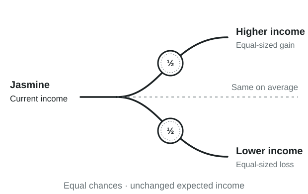{width="620" height="390" fig-alt="A single curved lottery diagram shows Jasmine’s current income branching into equally likely higher and lower income. Equal-sized gains and losses leave expected income unchanged, as shown by the dashed central line."}
:::
::: {.prose}
[Survey question]{.colhead}

Imagine the following scenarios: over the next 12 months, your household income will either **increase by 20% or decrease by 20%**. Both scenarios would happen with **equal chance**.

Only based on the above information, how would you now allocate your **current month's household income**?

**Note:** The numbers you enter across all categories must add up to **100**.

::: {.allocation-fields}
For spending [____%]{.allocation-blank}

For saving [____%]{.allocation-blank}

For debt repayment [____%]{.allocation-blank}
:::

:::
:::

::: {.prose}
[**The spread changes; expected income stays fixed.**]{.mps-takeaway}

:::

[Back to survey flow](#design){.example-button} [Back to challenge 2 solution](#panel){.example-button} [Original survey screen](#survey){.example-button}

::: {.notes}
The diagram shows a single mean-preserving spread from guaranteed current income to equally likely higher and lower income. The gain and loss have equal magnitude. The dashed central line marks unchanged expected income. The diagram intentionally omits numerical treatment sizes; the survey wording alongside it provides the concrete experimental example. This describes the scenario mean, not evidence that every respondent interprets the mean identically. The slide uses the presenter-provided survey wording, with spelling and grammar corrected. Blank fields illustrate the response categories and contain no assumed answers. Responses allocate current monthly income, not hypothetical future income. Outcomes are stated choices. The original screenshot is linked separately.
:::


## The vignette as the respondent saw it {#survey visibility="uncounted"}

::: {.figwrap .raster .tall .mono}
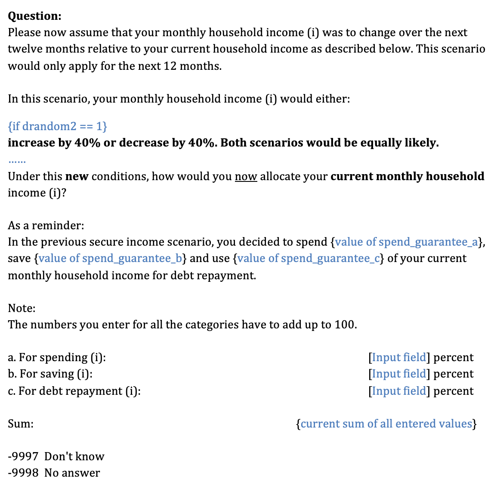
:::

[The ±40 branch of the stage-1 question, with the reminder of the respondent's own split under the guarantee. [Back to survey flow](#design).]{.figcap}

## The guaranteed-income anchor is itself a shock {#guarantee visibility="uncounted"}

::: {.split .wide-left}
::: {.figwrap}
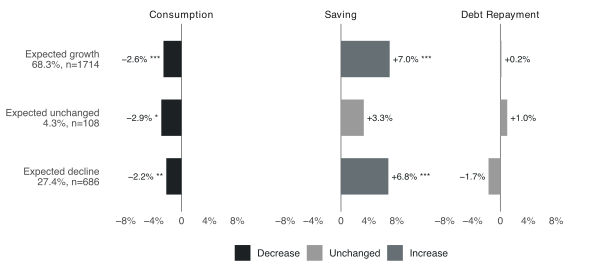
:::
::: {.prose}
Relative to their prior allocation, households told their income is guaranteed unchanged cut the spending share by about [[]{.data key="guarantee.0.b" d="1" mul="100" abs="1"}]{.num .primary-t} percent and raise the saving share by about [[]{.data key="guarantee.1.b" d="1" mul="100" abs="1"}]{.num .contrast-t} percent. Debt repayment does not move.

The 68 percent who expected income growth read "unchanged" as bad news. Even the few who expected no change cut spending, so the hypothetical framing itself may move answers. Every stage-1 estimate is a change from this anchor.

[Paired tests on within-person log changes, guarantee minus prior; 2,121 / 1,898 / 1,074 respondents. Figure by prior expected income change, in percent. Dark: decrease. Grey: increase. [Back to the talk](#panel).]{.source}
:::
:::

## Prior allocations differ by belief, buffer stock and leverage {#prior visibility="uncounted"}

::: {.split .wide-left}
::: {.figwrap}
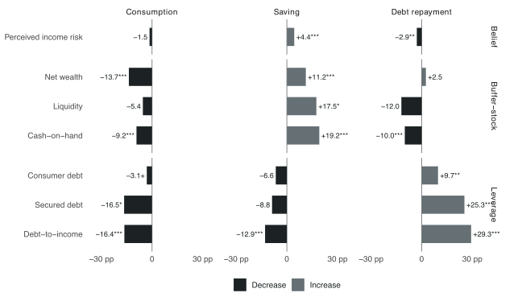
:::
::: {.prose}
Prior allocation out of 100: spending mean 65.8 and median 70, saving mean 20.8 and median 20, debt repayment mean 13.4 and median 5. 2,172 respondents, 1,342 with positive debt repayment.

High-minus-low tertile differences by variable. Perceived income uncertainty stands out as its own channel. Buffer-stock variables shift the spending–saving margin. Leverage shifts debt repayment.

[Dark: the high tertile allocates less. Grey: more. Stars are Benjamini–Hochberg adjusted, weighted F-tests. [Back to the talk](#lena-budget).]{.source}
:::
:::

## The section-1 estimates survive the non-parametric and baseline checks {#robust1 visibility="uncounted"}

::: {.split .even .cols}
::: {.prose}
[Wilcoxon signed-rank]{.colhead}

| Outcome | ±20 p | ±40 p | zero share 20 / 40 |
|---|---|---|---|
| Spending | <0.001 | <0.001 | 0.53 / 0.39 |
| Saving | 0.002 | <0.001 | 0.52 / 0.39 |
| Debt repayment | 0.001 | <0.001 | 0.86 / 0.80 |

961 / 938 respondents. The parametric results hold without distributional assumptions.
:::
::: {.prose}
[Baseline dependence]{.colhead}

| Model | β on baseline | p | R² |
|---|---|---|---|
| ΔSpending | −0.093 | <0.001 | 0.029 |
| ΔSaving | −0.122 | <0.001 | 0.036 |
| ΔDebt | +0.023 | 0.002 | 0.005 |

Baseline shares explain under 4 percent of the variation, so the responses are not mechanical rescalings. Regressing each response on demographic and financial groups gives almost no significant coefficients, so composition effects do not drive the averages.
:::
:::

[[Back to the talk](#intensive).]{.figcap}

## Order of presentation does not matter, with one marginal exception {#order visibility="uncounted"}

::: {.split .even .cols}
::: {.prose}
[Order effect]{.colhead}

Same level, different order: group 1 stage 2 vs group 3 stage 1, and vice versa. Two-sample t-tests; mean difference in allocation points (of 100) with the p-value in parentheses.

| Level | Spending | Saving | Debt |
|---|---|---|---|
| ±40 | 0.709 (0.40) | −0.456 (0.57) | −0.253 (0.55) |
| ±20 | 1.043 (0.05) | −0.675 (0.20) | −0.369 (0.20) |

One marginal result for spending at ±20, the same exception as in the talk.
:::
::: {.prose}
[Sequence-order interaction]{.colhead}

$\Delta_i = Y_{40,i} - Y_{20,i}$ regressed on an indicator for the 40→20 order.

| Outcome | Coefficient (SE) | p |
|---|---|---|
| Spending | 0.334 (0.572) | 0.56 |
| Saving | −0.240 (0.557) | 0.67 |
| Debt repayment | −0.094 (0.299) | 0.75 |

No path dependence or experimenter-demand effect in the within-person difference.
:::
:::

[[Back to the talk](#paths).]{.figcap}

## Stage-2 moves have the right sign, and are 13 to 29 percent of the stage-1 allocation {#signratio visibility="uncounted"}

::: {.split .even .cols}
::: {.prose}
[Sign test, among those who adjust]{.colhead}

| Direction | Spending | Saving | Debt |
|---|---|---|---|
| Increase 20→40, share ↑ | 0.36*** (220) | 0.59*** (216) | 0.65** (68) |
| Decrease 40→20, share ↓ | 0.67*** (222) | 0.37*** (213) | 0.41 (76) |

Binomial test against one half, n of adjusters in brackets. As the source reads it: 59 percent of savers increase when uncertainty rises, 67 percent of spenders decrease when it falls.
:::
::: {.prose}
[Ratio test, relative to the stage-1 allocation]{.colhead}

| Direction | Spending | Saving | Debt |
|---|---|---|---|
| 20→40 | −0.219** | +0.178** | +0.292*** |
| 40→20 | +0.156*** | −0.131*** | −0.095 |

Mean of the stage-2 change divided by the stage-1 allocation. Symmetric signs across directions. Wilcoxon tests reject no change for every outcome in both directions, and the absolute moves do not differ between directions.
:::
:::

[[Back to the talk](#paths).]{.figcap}

## Most respondents prefer the guarantee, and two in five say they prefer unknown odds {#preferences visibility="uncounted"}

::: {.figwrap .pair .wide}
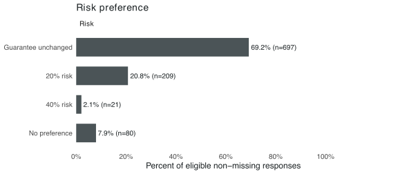
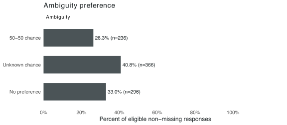
:::

[**Left:** which scenario respondents say they prefer (guarantee, ±20, ±40, no preference). **Right:** 50-50 odds versus unknown odds. Survey-weighted tests find no systematic demographic or balance-sheet differences across these preference groups; uncertainty preference is only weakly related to perceived income uncertainty. [Back to the talk](#readings).]{.figcap}

## The rational benchmark: a precautionary premium proportional to the variance {#model visibility="uncounted"}

::: {.split .even}
::: {.prose}
Each period the household splits resources across consumption $c$, liquid saving $a'$ and debt repayment $x$:
$$V(a,b,y;F)=\max_{c,a',x}\{u(c)+\beta\,\mathbb{E}_F[V(a',b',y';F)]\}$$
with $c + a' + x = y + R_a a$ and $b' = R_b b - x$. CRRA utility gives $u''' > 0$, prudence, the source of the precautionary motive [@skinner_risky_1988; @kimball_precautionary_1990].
:::
::: {.prose}
The vignette is a binary mean-preserving spread, $y' \in \{\bar y - d, \bar y + d\}$ with $d = \delta \bar y$.

The precautionary premium is $\psi \approx \tfrac12 \eta\,\sigma^2$, where $\eta = -u'''/u''$ is absolute prudence and $\sigma^2 = (\delta \bar y)^2$. So $\psi$ is quadratic in $\delta$: moving from 0.2 to 0.4 quadruples it, while a response linear in $\delta$ doubles.

| Shock | ΔC | ΔS | ΔD | size |
|---|---|---|---|---|
| 0 → 0.2 | ↓ | ↑ | ↑ | $\psi_{20}$ |
| 0 → 0.4 | ↓ | ↑ | ↑ | $4\psi_{20}$ |
| 0.2 → 0.4 | ↓ | ↑ | ↑ | $3\psi_{20}$ |
| 0.4 → 0.2 | ↑ | ↓ | ↓ | $-3\psi_{20}$ |

[[Back to the talk](#scaling).]{.figcap}
:::
:::

## Response scaling: comparison with theoretical benchmarks {#scaling-benchmarks visibility="uncounted"}

::: {.split}
::: {.prose}
A response linear in the spread would **double**. Under the standard precautionary benchmark the premium is proportional to the *variance*, so it would **quadruple** [@kimball_precautionary_1990].

The three ratios land in between, at [[]{.data key="intensive.rows.0.ratio" d="1"}]{.num .primary-t}, [[]{.data key="intensive.rows.1.ratio" d="1"}]{.num .contrast-t} and [[]{.data key="intensive.rows.2.ratio" d="1"}]{.num .actor-a-t} times.

Their intervals are wide. The data say "more than proportional" clearly, and cannot pick between the two benchmarks.

[Ratio of the ±40 to the ±20 estimate, with delta-method 95% intervals treating the two groups as independent. [Model](#model){.example-button} [Back to results](#scaling){.example-button}]{.room}
:::
```{=html}
<div class="stage" data-chart="scaling"></div>
```
:::

::: {.notes}
The two curves are stylised benchmarks, the three dots are the ratios from the previous slide, the whiskers are delta-method intervals computed from the slide's own standard errors. Say the honest version: the point estimates sit at three, the intervals reach both two and four. What survives is that the response is at least proportional to the spread. The appendix room has the model and why the premium scales with the variance.
:::

## Two readings make opposite predictions when the probabilities disappear {#readings visibility="uncounted"}

::: {.split .even .cols}
::: {.prose}
[Reading one: [ambiguity aversion]{.actor-b-t}]{.colhead}

Households treat unknown odds as worse than known ones [@gilboa_maxmin_1989]. Macro models with ambiguity-averse households predict a **stronger** precautionary cut when the probability is withdrawn [@ilut_ambiguous_2014; @ilut_hanks_2025].
:::
::: {.prose}
[Reading two: retained beliefs, or inertia]{.colhead}

Households already hold a probability in mind [@andre2026people], and the form shows them their previous split. Telling them the odds are unknown changes **nothing**.

Asked directly, only a quarter of respondents say they prefer 50-50 odds to unknown ones.
:::
:::

::: {.prose}
[Max, in group 2, faced the ±20 coin flip and chose his split. Now the odds are withdrawn. Which reading wins?]{.q}

[Back to ambiguity](#design-ambiguity){.example-button}

[What respondents say they prefer: [stated preferences](#preferences).]{.room}
:::

::: {.notes}
Third bet. Hands for "stronger response", hands for "no change". In most macro rooms the first column wins the vote, which is what makes the next slide land. The stated preference is in the appendix: 26 percent prefer 50-50, 41 percent prefer unknown odds, 33 percent have no preference.
:::

## MPC literature and the contribution of this experiment {#mpc-literature visibility="uncounted"}

::: {.prose}
- **Heterogeneity and household balance sheets:** [@jappelli_fiscal_2014; @fagereng_mpc_2021; @kaplan_marginal_2022].
- **Experimental transfers and survey elicitation:** [@boehm_five_2025; @crossley_eliciting_2025].
- **The link to subjective uncertainty:** [@kosar_subjective_2025] relates earnings uncertainty to reported MPCs and evaluates consumption–saving models.

**Our contribution:** vary income uncertainty while holding expected income in the scenario fixed, and measure adjustments in current stated consumption, saving and debt repayment within households.

**Different estimand:** an MPC measures the consumption response per unit of additional income. Here, the treatment changes the income distribution's spread without adding income.

[Back to literature](#lit){.example-button} [Back to motivation](#why-hard){.example-button}
:::

::: {.notes}
Jappelli and Pistaferri studies reported responses and heterogeneity. Fagereng, Holm and Natvik uses lottery prizes and household balance sheets. Boehm, Fize and Jaravel provides randomized-transfer evidence. Crossley and coauthors shows that survey wording affects elicited MPCs, relevant to interpreting hypothetical allocations. Koşar and Melcangi is particularly close: subjective uncertainty covaries with reported MPCs, and they compare that relationship with consumption–saving models. Our experiment contributes exogenous scenario variation in the spread, rather than a new estimate of an MPC. Avoid claiming that the existing MPC literature lacks causal identification: randomized-transfer studies already provide it for their own estimand.
:::

## All path-dependence comparisons {#all-path-differences visibility="uncounted"}

```{=html}
<div class="stage" data-chart="pathdiff"></div>
```

[Back to the spending exception](#paths){.example-button}

## Responses differ widely and come in round steps {#hetero-distribution visibility="uncounted"}

::: {.stats}
::: {.stat}
[45%]{.k .f}
[leave the allocation unchanged]{.l}
:::
::: {.stat}
[5 or 10 pp]{.k .f}
[common adjustment sizes]{.l}
:::
::: {.stat}
[76%]{.k .f}
[of saving cutters cut saving again in the subsequent scenario]{.l}
:::
:::

::: {.prose}
- More than **95%** of allocation answers are multiples of five.
- About **one in five** households cuts saving, opposite to the usual precautionary-saving prediction.
:::

[A small average response can hide households moving in opposite directions.]{.slide-takeaway}

[Back to heterogeneity conclusions](#heterogeneity-summary){.example-button} [Financial circumstances](#heterogeneity-finances){.example-button}

::: {.notes}
Source: user-supplied heterogeneity results, “Responses differ widely, and come in round steps.” These are the reported summary statistics, not reconstructed microdata. The source does not specify the aggregation behind the 45% unchanged statistic, so do not equate it with a particular outcome-specific extensive-margin estimate. The referenced fig_stage1_response_hist.pdf was not available in the presentation folder. No histogram is inferred from these summaries. Percentage points (pp) refer to changes in allocation shares; the multiple-of-five statistic refers to reported answers.
:::

## Prior uncertainty: little predictive evidence in these tests {#hetero-prior visibility="uncounted"}

::: {.prose}
**Two interpretations:** households may respond to the vignette net of prior uncertainty (“increment”), or combine it with prior uncertainty (“stacking”).

| Outcome | Treatment per pp, $\theta$ | Prior uncertainty coefficient | Increment test: $\beta_{pre}+\theta$ |
|---|---:|---:|---:|
| Consumption | −0.072 | −0.138 | −0.210* |
| Saving | +0.045 | +0.180 | +0.224* |

- **Within-person test:** $N=228$; $\theta=\beta_{40}/20$.
- Prior coefficients have the same sign as the treatment effect, but are **not statistically significant**.
- First-spread regressions: $N\approx400$, joint $p=0.12$–$0.98$; adding prior uncertainty increases $R^2$ by at most 0.03.
:::

[The increment restriction is rejected; the estimates do not establish a stacking mechanism.]{.slide-takeaway}

[Back to heterogeneity conclusions](#heterogeneity-summary){.example-button} [Financial circumstances](#heterogeneity-finances){.example-button}

::: {.notes}
Source: supplied “Pre-existing uncertainty” and “Increment is rejected” slides. Coefficients and stars are reproduced as supplied; the source does not specify the star threshold. The simple increment restriction is beta_pre + theta = 0. The signs are consistent with stacking but do not identify it. The modest belief-data subsample limits precision. The supplied point-estimate sums reflect underlying rounding: the saving test is reported as 0.224 although the displayed components sum to 0.225. Preserve the reported test rather than recomputing from rounded inputs. The supplied text compares prior and vignette uncertainty in percentage units; interpreting their sum requires consistent measurement and is a behavioral hypothesis, not an identity.
:::

## Actual allocations help explain vignette responses {#hetero-budget visibility="uncounted"}

::: {.prose}
| Finding | Reported result |
|---|---:|
| Identical actual and guaranteed-income allocations | 78% |
| Actual consumption coefficient, controlling for guaranteed-income allocation | 0.30** |
| Coefficient after adding prior perceived uncertainty | 0.29 |

The prior-uncertainty coefficient remains insignificant.
:::

[Actual budgets predict stated allocations beyond the guaranteed-income benchmark.]{.slide-takeaway}

[Back to heterogeneity conclusions](#heterogeneity-summary){.example-button} [Financial circumstances](#heterogeneity-finances){.example-button}

::: {.notes}
Source: supplied “What carries over is the real budget” slide. Coefficients describe the relationship of the first-spread consumption allocation to the actual allocation, holding the guaranteed-income allocation fixed. They are not causal effects of actual consumption. The guaranteed allocation may reflect desired behavior under certainty; an aspirational interpretation is not directly established. The supplied source does not define the significance-star threshold. Do not interpret the absence of a significant uncertainty coefficient as proof that beliefs never matter.
:::

## Income differences in allocation responses {#hetero-income visibility="uncounted"}

```{=html}
<div class="income-heterogeneity-layout">
  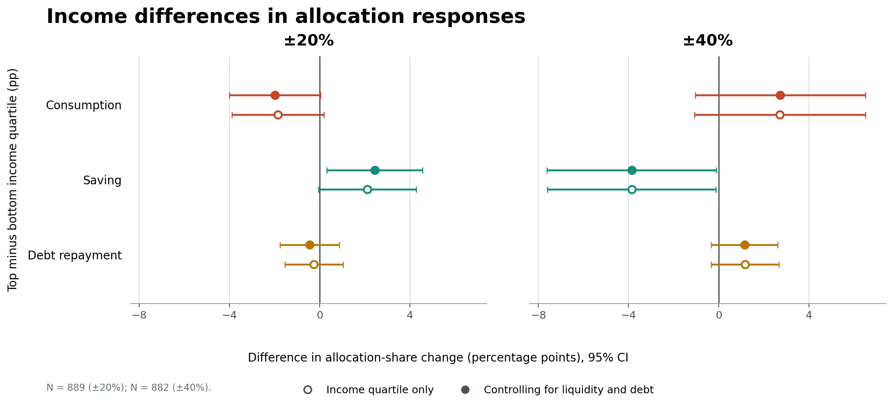
  <div class="income-baseline-stat">
    <h3>Income & allocation · ±20%</h3>
    <p class="income-stat-caption">Income: weighted mean €/mo · allocation: %</p>
    <table class="income-summary-table">
      <thead><tr><th>Quartile</th><th>HH inc.</th><th>Cons.</th><th>Save</th><th>Debt</th></tr></thead>
      <tbody>
        <tr><th>Bottom</th><td>2,496</td><td>71.0</td><td>19.5</td><td>9.5</td></tr>
        <tr><th>Top</th><td>10,357</td><td>51.7</td><td>33.0</td><td>15.4</td></tr>
      </tbody>
    </table>
    <p class="income-stat-n">Allocation N: bottom=230; top=83.</p>
  </div>
</div>
<ol class="income-heterogeneity-takeaways">
  <li>At ±20%, higher-income households cut consumption more and raise saving more.</li>
  <li>Bottom-income households allocate 71.0% to consumption under uncertainty, versus 51.7% for the top quartile; this high allocation may limit further cuts.</li>
  <li>Debt repayment is not significantly related to household income at either uncertainty level.</li>
</ol>
```

[Back to financial circumstances](#heterogeneity-finances){.example-button}

::: {.notes}
Contrasts are top income quartile minus bottom income quartile from the user's updated regression output. Outcome is the change in allocation share (percentage points). Open points show the income-quartile-only specification; filled points additionally control for liquidity and debt. At ±20%, the adjusted consumption contrast is −1.987 pp (p=.055) and the adjusted saving contrast is +2.434 pp (p=.025); the adjusted debt contrast is not significant (p=.506). At ±40%, only the saving contrast is statistically distinguishable from zero: −3.862 pp (p=.044), meaning the top quartile increases saving less than the bottom quartile. N=889 at ±20%; N=882 at ±40%. The right-hand table combines weighted mean monthly household income and ±20% uncertainty-stage weighted allocation means. Income weighted means use N=481 (bottom) and N=182 (top); allocation means use N=230 and N=83, respectively. Income is not randomized, so these are conditional associations, not causal income effects. The possible spending-capacity interpretation is suggestive, not directly tested.
:::

## High-liquidity households are less likely to increase debt repayment {#hetero-liquidity visibility="uncounted"}

```{=html}
<div class="liquidity-heterogeneity-layout">
  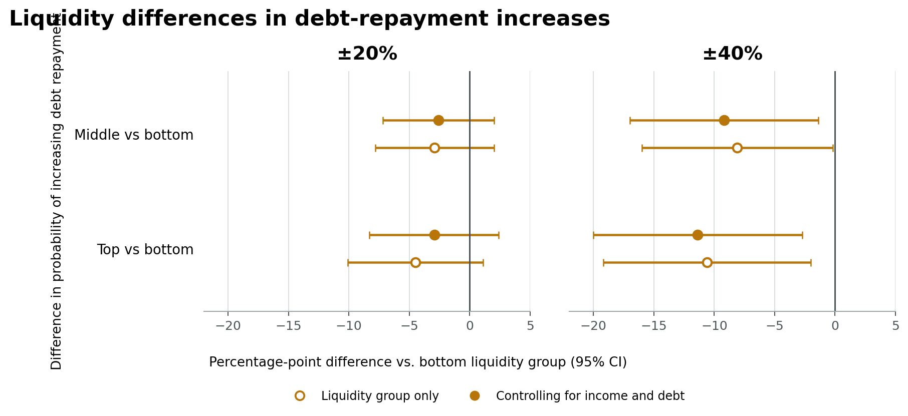
  <div class="liquidity-summary">
    <h3>Liquidity-to-income by group</h3>
    <p>Weighted mean L/I ratio; repayment-increase rate and N</p>
    <table>
      <thead><tr><th>Group</th><th>Mean L/I</th><th>±20%<br>rate (N)</th><th>±40%<br>rate (N)</th></tr></thead>
      <tbody>
        <tr><th>Bottom</th><td>0.70</td><td>9.5% (230)</td><td>18.9% (214)</td></tr>
        <tr><th>Middle</th><td>8.81</td><td>6.6% (447)</td><td>10.8% (438)</td></tr>
        <tr><th>Top</th><td>52.6</td><td>5.0% (212)</td><td>8.3% (230)</td></tr>
      </tbody>
    </table>
  </div>
</div>
<ol class="liquidity-takeaways">
  <li>At ±40%, the middle and top groups are less likely than the bottom group to increase repayment; adjusted differences are −9.2 pp and −11.4 pp.</li>
  <li>Both differences are statistically significant (p=.021 and p=.010); their 95% confidence intervals exclude zero.</li>
</ol>
```

[Back to financial circumstances](#heterogeneity-finances){.example-button} [Explanatory shares](#hetero-shapley){.example-button}

::: {.notes}
The figure shows contrasts in the probability of increasing debt repayment, relative to the bottom liquidity group. At ±40%, liquidity-only differences are −8.1 pp for the middle group (95% CI [−16.0, −0.2], p=.045) and −10.6 pp for the top group (95% CI [−19.2, −2.0], p=.016). With income and debt controls, the differences are −9.2 pp (95% CI [−17.0, −1.4], p=.021) and −11.4 pp (95% CI [−20.0, −2.7], p=.010). At ±20%, neither contrast is significant. The table reports weighted mean liquidity-to-income ratios and repayment-increase rates with observations by uncertainty group. Liquidity is not randomized; estimates are conditional associations.
:::

## Do debt repayment adjusters change other allocations differently? {#debt-adjustment-groups}

```{=html}
<div class="debt-status-comparison">
  <div class="debt-status-panel">
    <h3>Debt repayment non-adjusters</h3>
    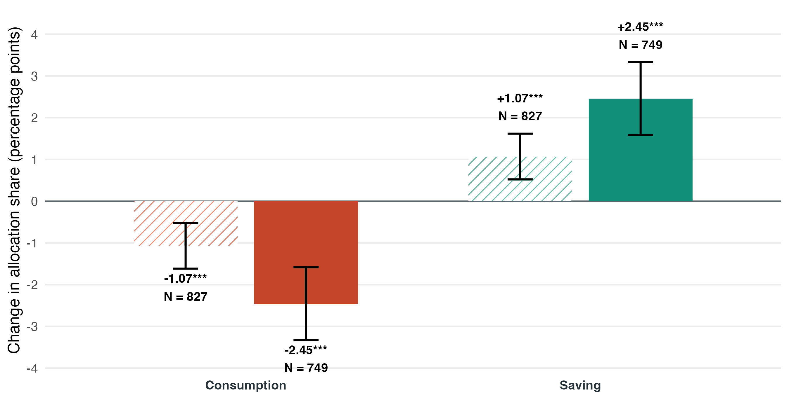
  </div>
  <div class="debt-status-panel">
    <h3>Debt repayment adjusters</h3>
    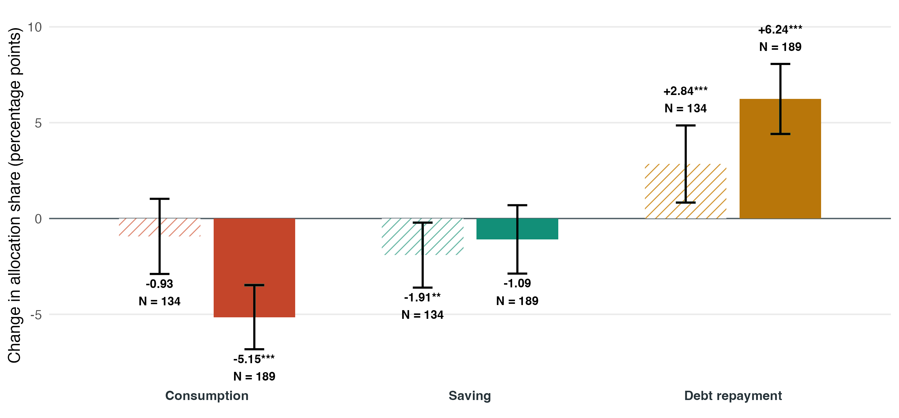
  </div>
</div>
<p class="debt-status-note">Mean within-household allocation changes in percentage points. Error bars are 95% confidence intervals; labels report N for each estimate. The non-adjuster sample has debt repayment unchanged within 0.1 percentage points.</p>
```

## Does debt type predict repayment increases? {#hetero-debt visibility="uncounted"}

```{=html}
<div class="debt-type-results-layout">
  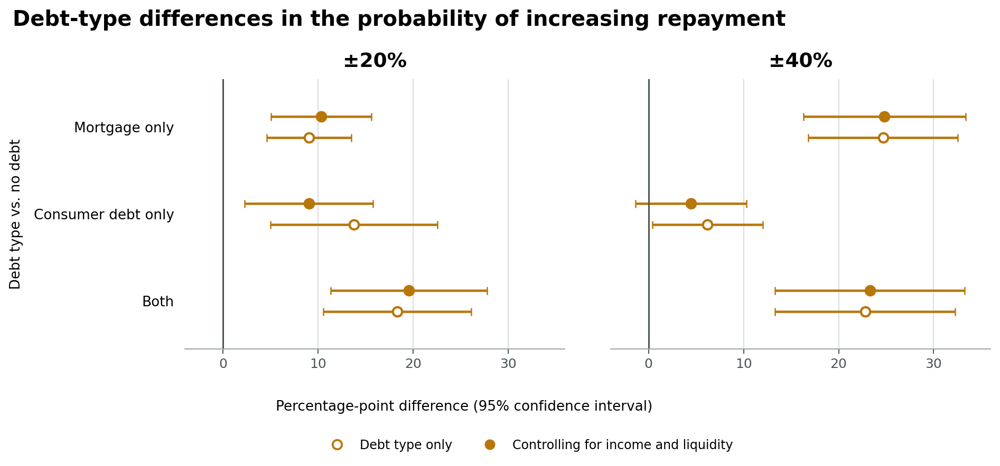
  <div class="debt-type-counts">
    <h3>Debt-type sample</h3>
    <p>Share within uncertainty group; observations in parentheses</p>
    <table>
      <thead><tr><th>Debt type</th><th>±20%</th><th>±40%</th></tr></thead>
      <tbody>
        <tr><th>No debt</th><td>48.3% (458)</td><td>47.2% (437)</td></tr>
        <tr><th>Mortgage only</th><td>24.4% (232)</td><td>26.9% (249)</td></tr>
        <tr><th>Consumer only</th><td>12.9% (122)</td><td>11.8% (109)</td></tr>
        <tr><th>Both</th><td>14.4% (137)</td><td>14.1% (130)</td></tr>
      </tbody>
    </table>
  </div>
</div>
<p class="debt-type-takeaway">At ±20%, consumer-debt-only households are more likely to raise repayment (+9 pp).<br>At ±40%, the strongest differences are among mortgage holders (+23–25 pp).</p>
```

[Repayment burden](#repayment-burden){.example-button} [Back to financial circumstances](#heterogeneity-finances){.example-button}

::: {.notes}
The chart shows weighted OLS contrasts in the probability of increasing debt repayment (change in repayment allocation >0.1 pp), relative to no debt, with HC3 robust standard errors. Open points are debt-type-only estimates; filled points additionally control for log household income and liquid-to-income ratio. At ±20%, adjusted differences are +10.4 pp for mortgage only (p<.001), +9.0 pp for consumer debt only (p=.009), and +19.6 pp for both (p<.001). At ±40%, mortgage only (+24.8 pp, p<.001) and both (+23.3 pp, p<.001) remain significant; consumer debt only (+4.5 pp, p=.133) does not. Reconstructed regression N is 950/925 without controls and 853/861 with controls at ±20%/±40%. User-supplied debt-type counts are shown in the table. The ±20% user counts sum to 949, one fewer than the reconstructed unadjusted regression sample; this small discrepancy should be reconciled against the latest analysis output. These are associations, not causal effects of debt type.
:::

## Repayment adjustments differ with the current burden {#repayment-burden visibility="uncounted"}

::: {.split .even .cols}
::: {.prose}
**Guaranteed income versus actual budget**

- **89% keep repayment unchanged**, consistent with a fixed commitment.
- **11% adjust**, in both directions.

| Debt type | Repay more (N = 103) | Repay less (N = 117) |
|:--|--:|--:|
| Mortgage only | 29% | 34% |
| Consumer debt only | 24% | 29% |
| Both | 29% | 21% |

Debt-type mix: **p = 0.65**.
:::
::: {.prose}
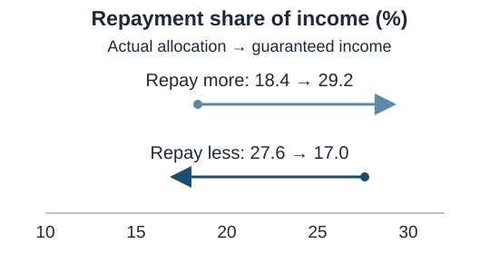{width="550" height="280" fig-alt="Repayment shares move from 18.4 to 29.2 percent among households repaying more, and from 27.6 to 17.0 percent among those repaying less, comparing actual with guaranteed-income allocations."}

- Lower current burden: repay more and cut consumption.
- Higher current burden: repay less and save more.
:::
:::

[Repayment shares converge; debt-type composition is not statistically distinguishable between the two groups.]{.slide-takeaway}

[Change = guaranteed-income minus actual allocation. Convergence may partly reflect regression to the mean.]{.source}

[Debt-type repayment results](#hetero-debt){.example-button} [Back to intensive margin](#intensive){.example-button}

::: {.notes}
Source: user-supplied debt repayment heterogeneity slides. This comparison removes uncertainty relative to the actual budget; it is distinct from the first-spread treatment versus guaranteed income on the preceding slide. The displayed debt-type percentages do not sum to 100%; categories and percentages are reproduced without inferring an unreported residual category. p = 0.65 does not establish equivalent debt-type composition. Burden associations do not identify causality and convergence may reflect regression to the mean.
:::

## Financial dimensions explain different margins {#hetero-shapley visibility="uncounted"}

::: {.prose}
**±20% spread: Shapley shares of the contribution explained by income, liquidity and debt**

| Outcome | Largest contribution | Share |
|---|---|---:|
| Saving amount | Income | 47% |
| Consumption amount | Debt | 53% |
| Debt repayment amount | Debt | 86% |
| Probability of raising saving | Liquidity | 51% |
| Probability of any adjustment | Liquidity | 53% |
:::

[Back to financial circumstances](#heterogeneity-finances){.example-button}

::: {.notes}
Source: supplied “Each dimension governs a different margin” slide. These are relative Shapley contributions within the R-squared explained jointly by the three financial dimensions. They are not causal effects or percentages of the full outcome variance. The source's fig_stage1_hetero_shapley_pp.pdf was not available; the numeric table is reproduced rather than reconstructing missing bars or intervals.
:::

## References {visibility="uncounted"}

::: {#refs}
:::
